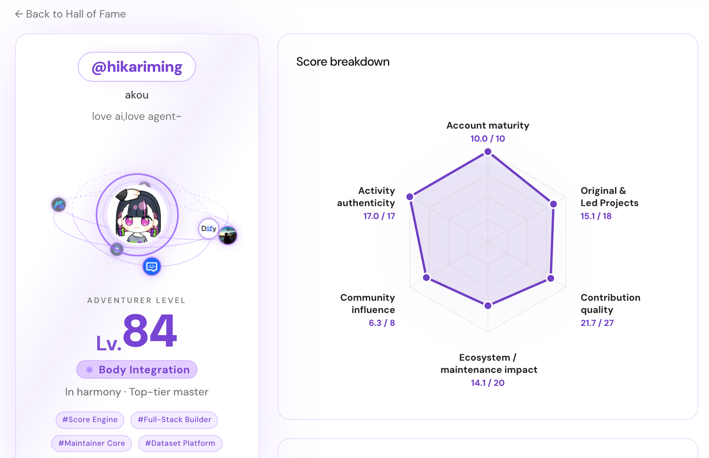
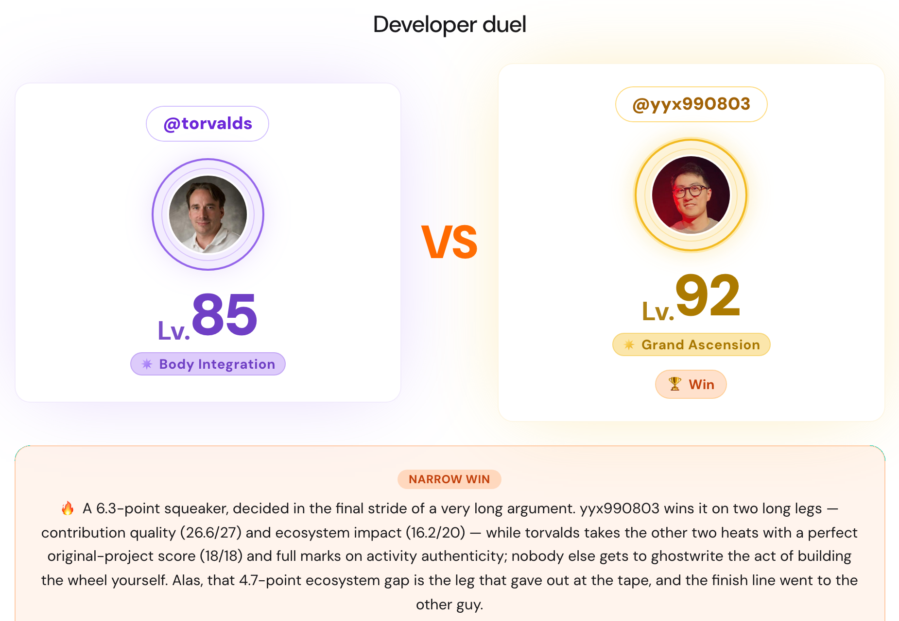

<div align="center">

# ghfind 🔥

### Discover the best developers — and become one.

An evidence-based platform to **find** great developers, **measure** where you stand, and **grow** from there.

**English** · [中文](./README.zh.md)

[**🔍 Score a GitHub profile**](https://ghfind.com/en) · [**🏆 Discover developers**](https://ghfind.com/en/leaderboard) · [**🤖 Install the GitHub App**](https://github.com/apps/ghfind-review/installations/new) · [**📚 Architecture**](./docs/architecture.md)

</div>

[](https://ghfind.com/en/u/hikariming)

## What you can do

- **Measure.** Enter a GitHub handle to get a deterministic **0–100 score** across six dimensions, a level and rating, the risk signals behind it, and an optional AI-written report.
- **Discover.** Browse the developer board, language/org/repo directories, project boards and the talent pool, or put two developers head to head.
- **Share.** Every profile has a live README badge and a light/dark developer card.
- **Maintain.** The ghfind Review GitHub App labels new issues and PRs with the author's score band.
- **Integrate.** The same data is available through a REST API, an MCP server, SDKs and a CLI.

[](https://ghfind.com/en/vs/torvalds/yyx990803)

## How scoring works

- **Deterministic.** Six dimensions — account maturity, original projects, contribution quality, ecosystem impact, community influence and activity authenticity — plus capped risk rules for farming patterns (star or fork farming, self-merged PRs, PR floods, bots). Same evidence and version, same score.
- **Hard-to-fake signals win.** Merged PRs into real projects and sustained activity weigh more than buyable stars and followers. Only public GitHub data is used, so mostly-private work is underrated.
- **Levels and ratings.** `Lv = floor(score)`. Ratings step every 10 points from 30:

  | Score | < 30 | 30 | 40 | 50 | 60 | 70 | 80 | 90+ |
  | --- | --- | --- | --- | --- | --- | --- | --- | --- |
  | Rating | Qi Condensation | Foundation Est. | Core Formation | Nascent Soul | Deity Transformation | Spatial Tempering | Body Integration | Grand Ascension |

- **AI never changes the number.** The report model writes tags and prose from the fixed score.
- **Open and verifiable.** The formula, risk rules and rating ladder are the public module [`scoring/`](./scoring) (TypeScript, Go and a Python port, locked together by shared fixtures). The SDKs (0.2+) recompute any published scan locally: `ghfind verify scan.json`.
- **Super newcomers.** Young accounts with strong, evidenced work can earn up to 4 extra maturity points, fading to zero by age 3 — see [the rule](./docs/scoring/super-newcomer.md).

## Share your profile

<div align="center">

[](https://ghfind.com/en/u/hikariming)

<a href="https://ghfind.com/en/u/hikariming">
  <picture>
    <source media="(prefers-color-scheme: dark)" srcset="https://ghfind.com/api/card/hikariming?theme=dark">
    <source media="(prefers-color-scheme: light)" srcset="https://ghfind.com/api/card/hikariming?theme=light">
    
  </picture>
</a>

</div>

## GitHub App: ghfind Review

Install **ghfind Review** and new issues and pull requests arrive labelled with the
author's public score band (`review:` labels at 40, 70 and 90; `review: no-score`
when no score is available). By default it doesn't comment, and it never blocks
or closes anything — a profile score is a starting point for triage, not a
verdict on the contribution. Labels are created automatically; no workflow or
secret is needed.

[**Install**](https://github.com/apps/ghfind-review/installations/new) · [Guide](https://ghfind.com/github-bot)

## API, MCP and SDKs

Full reference: **[ghfind.com/docs](https://ghfind.com/docs)**.

- **REST** — `GET https://ghfind.com/api/score/{username}` returns a deterministic score with no auth and no LLM. OpenAPI 3.1: [ghfind.com/openapi.json](https://ghfind.com/openapi.json).
- **MCP** — Streamable HTTP at [ghfind.com/mcp](https://ghfind.com/mcp) for Claude, Cursor or any MCP client.
- **SDKs + CLI** — [`@hikariming/ghfind`](https://www.npmjs.com/package/@hikariming/ghfind) (npm) · [`ghfind`](https://pypi.org/project/ghfind/) (PyPI) · the [Go CLI](./docs/development/cli.md).
- **For agents** — [ghfind.com/llms.txt](https://ghfind.com/llms.txt) links every machine-readable surface.

## This repository

ghfind is built from three repositories. This one is public:

| Repository | Visibility | What it holds |
| --- | --- | --- |
| **`FindAny/ghfind`** (this) | public | The scoring module ([`scoring/`](./scoring)), the JS and Python SDKs ([`packages/`](./packages)), the Go CLI ([`cmd/ghfind`](./cmd/ghfind)), agent skills, and every CI/CD and deploy workflow |
| `FindAny/ghfind-server` | private | API, GitHub collection, storage, Feed, Workers and the workspace configuration |
| `FindAny/ghfind-frontend` | private | Astro site, React components, messages and assets |

- **What you can verify.** Every production score is computed by the code in
  [`scoring/`](./scoring). The [`deploy`](https://github.com/FindAny/ghfind/tree/deploy)
  branch records each production release: its `components.manifest.json` names the
  exact `ghfind` release (and so the scoring code) that is live, next to the commits
  of the private components.
- **How it ships.** Each repository publishes `vX.Y.Z` releases. The latest verified
  release of all three is assembled into one workspace and deployed to Cloudflare
  from this repository. Details: [docs/architecture.md](./docs/architecture.md).

## Develop the scoring module, SDKs and CLI

Requires Node 22, pnpm 11, Go 1.23+ and Python 3.9+.

```bash
pnpm install
pnpm --filter @ghfind/scoring typecheck && pnpm --filter @ghfind/scoring test
pnpm scoring:boundary                         # purity, credential and import gate
(cd scoring && go test ./...)                 # Go port
(cd packages/ghfind-py && python3 -m pytest -q)
(cd packages/ghfind-js && npm ci && npm run typecheck && npm test)
go test ./internal/agentcli && go build -o bin/ghfind ./cmd/ghfind
```

Any formula change updates the TypeScript, Go and Python ports and their shared
fixtures in the same pull request; see [`scoring/README.md`](./scoring/README.md).
Pull requests from forks run the scoring CI; the full application suite runs on
maintainers' branches and on every production release. See
[CONTRIBUTING.md](./CONTRIBUTING.md) and [AGENTS.md](./AGENTS.md).

## Releases

- **Repository release:** a maintainer tags `vX.Y.Z` on a green `main`. The release
  workflow re-checks CI for that exact commit, marks it verified (`rel/vX.Y.Z`),
  publishes the GitHub release and starts a production composition.
- **Scoring package:** `scoring/vX.Y.Z` tags publish `@ghfind/scoring` and the Go
  module (`.github/workflows/scoring-release.yml`).
- **SDKs:** [`@hikariming/ghfind`](https://www.npmjs.com/package/@hikariming/ghfind) and
  [`ghfind`](https://pypi.org/project/ghfind/) are built from `packages/`.

## Bring your own model

Choose "Use your own model" on the site and enter a base URL, API key and model
for any OpenAI-compatible provider. The key stays in your browser's localStorage,
is sent only with your request and is never stored on the server.

## Disclaimer

Scores and commentary are generated automatically from **public GitHub data
only**. They describe public activity, are not a judgement of a person, are not
findings of fact and must not be used for harassment.

## Sponsorship and fairness

Sponsorship helps cover GitHub API, LLM and hosting costs. It never affects any
score, rank or risk conclusion — scores come only from the public
[`scoring/`](./scoring) module — and sponsor placements are kept separate from
ranking data.

## License

[GNU AGPL-3.0](./LICENSE). You may use, modify and self-host this project; if you
offer a modified version as a network service, AGPL requires you to publish your
modifications under the same license. The scoring formula began as a port of the
open-source Claude skill `github-account-value` and has since evolved here in
[`scoring/`](./scoring), which is now its source of truth.

> **Trademark:** the "ghfind / 毒舌 GitHub 评分" name, logo and domain are not
> covered by the license. Please don't use them to impersonate the official site.
