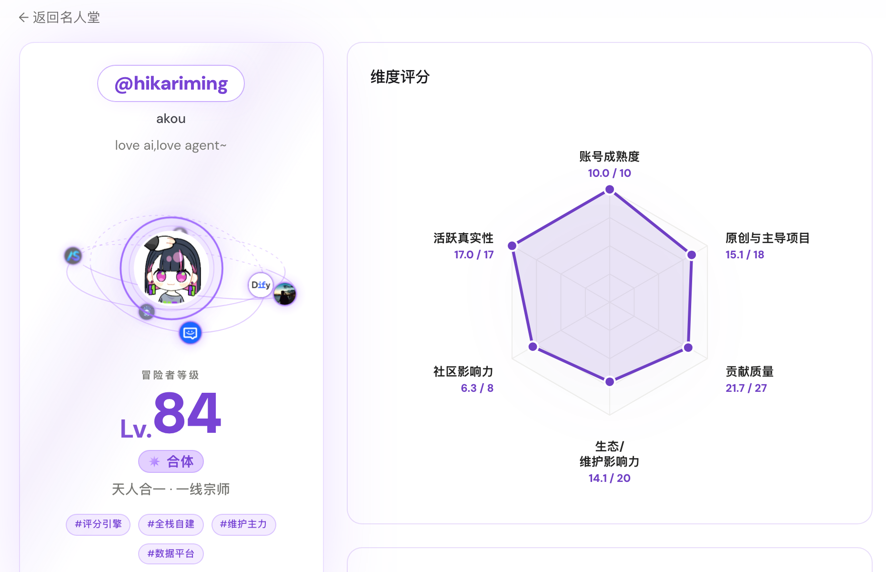

<div align="center">

# ghfind 🔥

### 发现最佳开发者，也成为其中之一。

一个基于真实公开数据的平台：**发现**优秀开发者、**看清**自己的位置、并从这里**成长**。

[English](./README.md) · **中文**

[**🔍 测测 GitHub 成色**](https://ghfind.com) · [**🏆 发现最佳开发者**](https://ghfind.com/leaderboard) · [**🤖 安装 GitHub App**](https://github.com/apps/ghfind-review/installations/new) · [**📚 架构**](./docs/architecture.md)

</div>

[](https://ghfind.com/u/hikariming)

## 能做什么

- **看清自己。** 输入 GitHub 用户名，得到六个维度的确定性 **0–100 分**、等级与评级、背后的风险信号，以及可选的 AI 毒舌报告。
- **发现开发者。** 浏览开发者榜、语言 / 组织 / 仓库目录、项目榜和人才库，或者让两位开发者正面 PK。
- **展示身份。** 每个个人页都有实时更新的 README 徽章和适配明暗主题的开发者卡片。
- **辅助维护。** ghfind Review GitHub App 给新 issue 和 PR 打上作者评分区间标签。
- **接入集成。** 同一套数据可通过 REST API、MCP 服务器、SDK 和 CLI 调用。

[](https://ghfind.com/vs/torvalds/yyx990803)

## 评分怎么算

- **确定性。** 六个维度——账号成熟度、原创项目、贡献质量、外部生态贡献、社区影响力、活跃真实性——外加封顶的风险规则，识别刷星 / 刷 fork、自产自合 PR、PR 刷量和机器人等模式。同一评分版本、同一份证据，结果相同。
- **难以造假的信号优先。** 合并进真实项目的 PR 和持续活跃比可购买的 star、粉丝更重要。只使用 GitHub 公开数据，主要在私有组织工作的开发者可能被低估。
- **等级与评级。** `Lv = floor(分数)`；30 分起每 10 分一级，恰在分界上归入更高一级：

  | 分数 | < 30 | 30 | 40 | 50 | 60 | 70 | 80 | 90+ |
  | --- | --- | --- | --- | --- | --- | --- | --- | --- |
  | 评级 | 练气 | 筑基 | 金丹 | 元婴 | 化神 | 炼虚 | 合体 | 大乘 |

- **AI 不改分。** 报告模型只根据已确定的分数写标签与文字。
- **公开、可验证。** 评分公式、风险规则和评级阶梯是公开模块 [`scoring/`](./scoring)（TypeScript、Go 及 Python 端口，由共享夹具锁定一致）。SDK（0.2 起）可在本地重算任一已发布扫描：`ghfind verify scan.json`。
- **超级新人红利。** 有采样证据、各项表现都优秀的新账号，成熟度内最多额外加 4 分，满 3 年衰减为零，详见[算法与边界](./docs/scoring/super-newcomer.md)。

## 展示你的主页

<div align="center">

[](https://ghfind.com/u/hikariming)

<a href="https://ghfind.com/u/hikariming">
  <picture>
    <source media="(prefers-color-scheme: dark)" srcset="https://ghfind.com/api/card/hikariming?theme=dark">
    <source media="(prefers-color-scheme: light)" srcset="https://ghfind.com/api/card/hikariming?theme=light">
    
  </picture>
</a>

</div>

## GitHub App：ghfind Review

安装 **ghfind Review** 后，新建的 issue 和 pull request 会带上作者的公开评分区间标签
（`review:` 区间阈值为 40、70、90；无评分时为 `review: no-score`）。默认不发评论，
也从不拦截或关闭提交——账号评分是分流线索，不代表这次贡献的质量。App 自动补齐
标签，无需在仓库添加 workflow 或 secret。

[**安装**](https://github.com/apps/ghfind-review/installations/new) · [使用指南](https://ghfind.com/github-bot)

## API、MCP 与 SDK

完整参考见 **[ghfind API 文档](https://ghfind.com/docs)**。

- **REST** — `GET https://ghfind.com/api/score/{username}` 返回确定性分数，无需认证、不经过 LLM。OpenAPI 3.1：[ghfind.com/openapi.json](https://ghfind.com/openapi.json)。
- **MCP** — Streamable HTTP，位于 [ghfind.com/mcp](https://ghfind.com/mcp)，可接入 Claude、Cursor 等任意 MCP 客户端。
- **SDK + CLI** — [`@hikariming/ghfind`](https://www.npmjs.com/package/@hikariming/ghfind)（npm）· [`ghfind`](https://pypi.org/project/ghfind/)（PyPI）· [Go CLI](./docs/development/cli.md)。
- **面向 Agent** — [ghfind.com/llms.txt](https://ghfind.com/llms.txt) 汇总所有机器可读入口。

## 本仓库

ghfind 由三个仓库组成，本仓库公开：

| 仓库 | 可见性 | 内容 |
| --- | --- | --- |
| **`FindAny/ghfind`**（本仓库） | 公开 | 评分模块（[`scoring/`](./scoring)）、JS 与 Python SDK（[`packages/`](./packages)）、Go CLI（[`cmd/ghfind`](./cmd/ghfind)）、Agent 技能，以及全部 CI/CD 与部署工作流 |
| `FindAny/ghfind-server` | 私有 | API、GitHub 采集、存储、Feed、Workers 与工作区配置 |
| `FindAny/ghfind-frontend` | 私有 | Astro 站点、React 组件、多语言文案与静态资源 |

- **可以核验什么。** 线上每一个分数都由 [`scoring/`](./scoring) 中的代码计算。
  [`deploy`](https://github.com/FindAny/ghfind/tree/deploy) 分支记录每次生产发布：其中的
  `components.manifest.json` 写明线上使用的 `ghfind` 版本（即评分代码版本），以及两个私有组件的提交。
- **如何上线。** 三个仓库各自发布 `vX.Y.Z` 版本；三者最新的已验证版本被组装成一个工作区，由本仓库部署到
  Cloudflare。详见 [docs/architecture.md](./docs/architecture.md)。

## 开发评分模块、SDK 与 CLI

需要 Node 22、pnpm 11、Go 1.23+、Python 3.9+。

```bash
pnpm install
pnpm --filter @ghfind/scoring typecheck && pnpm --filter @ghfind/scoring test
pnpm scoring:boundary                         # 纯净性、凭据与依赖闸门
(cd scoring && go test ./...)                 # Go 端
(cd packages/ghfind-py && python3 -m pytest -q)
(cd packages/ghfind-js && npm ci && npm run typecheck && npm test)
go test ./internal/agentcli && go build -o bin/ghfind ./cmd/ghfind
```

修改公式时，TypeScript、Go、Python 三端与共享夹具须在同一个 PR 中同步，见
[`scoring/README.md`](./scoring/README.md)。来自 fork 的 PR 运行评分 CI；完整应用测试在维护者分支和每次生产发布时运行。
另见 [CONTRIBUTING.md](./CONTRIBUTING.md) 与 [AGENTS.md](./AGENTS.md)。

## 发布

- **仓库版本：** 维护者在 CI 通过的 `main` 上打 `vX.Y.Z` 标签。发布工作流会再次确认该提交的 CI，标记为已验证
  （`rel/vX.Y.Z`），发布 GitHub Release，并触发一次生产组装。
- **评分包：** `scoring/vX.Y.Z` 标签发布 `@ghfind/scoring` 与 Go module（`.github/workflows/scoring-release.yml`）。
- **SDK：** [`@hikariming/ghfind`](https://www.npmjs.com/package/@hikariming/ghfind) 与
  [`ghfind`](https://pypi.org/project/ghfind/) 由 `packages/` 构建。

## 自带模型

在页面上选择「用自己的模型」，填入任意 OpenAI 兼容服务的 Base URL、API Key 和模型名。Key 只
保存在你浏览器的 localStorage 中，随请求直接发送，不会上传或保存到服务器。

## 免责声明

评分与点评完全基于 **GitHub 公开数据**自动生成，描述的是公开行为，不是对个人的评判，也不构成
事实认定，不得用于骚扰。

## 赞助与公正性

赞助用于支付 GitHub API、LLM 与托管费用，不会影响任何分数、排名或风险结论——分数只来自公开的
[`scoring/`](./scoring) 模块；赞助展示与榜单数据相互分离。

## 许可证

[GNU AGPL-3.0](./LICENSE)。你可以使用、修改和自托管本项目；如果把修改后的版本作为网络服务提供，
AGPL 要求你以同一许可证公开修改。评分公式最初移植自开源 Claude 技能 `github-account-value`，之后在
本仓库 [`scoring/`](./scoring) 中持续演进，现以此为准。

> **商标：** 「ghfind / 毒舌 GitHub 评分」名称、Logo 与域名不在开源许可范围内，保留所有权利。请勿用于
> 冒充官方站点。
